<p align="center"><a href="README.md">English</a> · <b>Español</b></p>

<p align="center">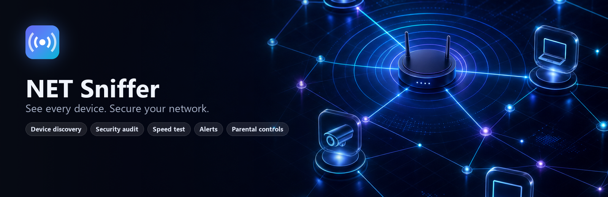</p>

<p align="center">
  <a href="https://github.com/crazyramirez/NET-Sniffer/releases/latest"></a>
  
  
  
</p>

**NET Sniffer** es una app de escritorio gratuita que te muestra todos los dispositivos de tu Wi-Fi o red local, audita la seguridad de tu red, mide la velocidad de internet y te avisa en cuanto algo cambia. Sigue vigilando desde la bandeja del sistema, tiene tema claro y oscuro, y está en 7 idiomas.

> Pensada para **redes que son tuyas o que administras**. NET Sniffer solo usa protocolos de descubrimiento estándar y comprobaciones de conexión. No explota vulnerabilidades, no prueba contraseñas, no intercepta tráfico y no hace ARP spoofing.

<p align="center">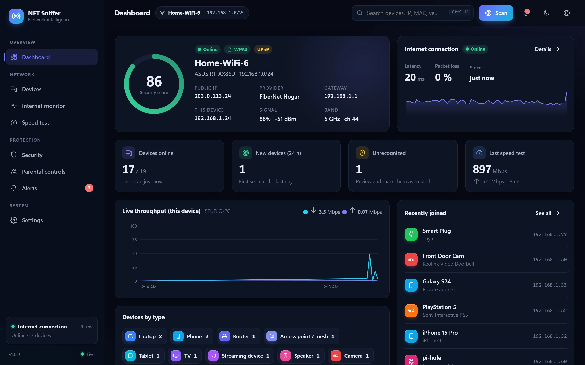</p>

## Descarga e instalación

| Plataforma | Instalador |
|---|---|
| **Windows 10/11** (x64) | [NETSniffer-Setup-Windows-x64.exe](https://github.com/crazyramirez/NET-Sniffer/releases/latest/download/NETSniffer-Setup-Windows-x64.exe) |
| **macOS** Apple Silicon | [NETSniffer-macOS-arm64.dmg](https://github.com/crazyramirez/NET-Sniffer/releases/latest/download/NETSniffer-macOS-arm64.dmg) |
| **macOS** Intel | [NETSniffer-macOS-x64.dmg](https://github.com/crazyramirez/NET-Sniffer/releases/latest/download/NETSniffer-macOS-x64.dmg) |
| **Linux** x64 (Ubuntu, Debian, Mint…) | [NETSniffer-Linux-x64.deb](https://github.com/crazyramirez/NET-Sniffer/releases/latest/download/NETSniffer-Linux-x64.deb) |
| **Linux** ARM64 | [NETSniffer-Linux-arm64.deb](https://github.com/crazyramirez/NET-Sniffer/releases/latest/download/NETSniffer-Linux-arm64.deb) |
| **Raspberry Pi** / servidor doméstico (sin pantalla) | [instalación con un comando](#raspberry-pi--servidor-doméstico) |

- **Windows**: ejecuta el instalador.
  - Se instala solo para tu usuario, sin permisos de administrador.
  - Crea acceso en el menú Inicio y, si quieres, en el escritorio. Puede arrancar con Windows y se desinstala como cualquier programa.
  - SmartScreen puede avisar porque la app aún no está firmada: *Más información* → *Ejecutar de todas formas*.
- **macOS**: abre el `.dmg`, arrastra **NET Sniffer** a *Aplicaciones* y la primera vez ábrela con clic derecho → *Abrir*. La app aún no está notarizada.
- **Linux**: `sudo apt install ./NETSniffer-Linux-x64.deb` y búscala como **NET Sniffer** en el menú de aplicaciones.
  - La ventana nativa y el icono de bandeja usan GTK/WebKit (`gir1.2-webkit2-4.1`, `gir1.2-ayatanaappindicator3-0.1`).
  - Sin ellos, la interfaz se abre en el navegador.

**Siempre actualizada.** NET Sniffer consulta GitHub Releases cada pocas horas y descarga la nueva versión en segundo plano. La instala al reiniciar la app, o al momento con *Instalar y reiniciar*. Solo se publica siempre la última versión.

## Funciones

**Ve todo lo que hay en tu red**
- **Descubrimiento de dispositivos**:
  - Muestra IP, MAC, fabricante (registro IEEE), modelo, nombre de host, sistema operativo estimado y tipo de dispositivo: router, móvil, portátil, TV, cámara, impresora, consola, IoT…
  - Usa resolución ARP, mDNS/Bonjour, NetBIOS, SSDP/UPnP y WS-Discovery.
  - No necesita permisos de administrador.
- **Historial de conexiones**: primera y última vez visto, línea temporal de conexiones y desconexiones, cambios de IP y detección de direcciones MAC privadas (aleatorias).
- **Puertos y servicios**: inventario TCP rápido, común (~120) o completo (~1.100) por dispositivo, con banners de servicio y nivel de riesgo.
- **Ping, Wake-on-LAN, acceso a la web del dispositivo, notas, favoritos y exportación a CSV.**

**Protégela**
- **Detección de intrusos**: marca tus dispositivos como de confianza; los dispositivos nuevos o desconocidos generan una alerta en menos de 90 segundos.
- **Auditoría de seguridad**:
  - Puntuación y nota para tu red, con pasos detallados para corregir cada hallazgo y exportación del informe a HTML.
  - Revisa el cifrado Wi-Fi, la exposición por UPnP, si el panel del router va sin HTTPS y si hay servicios de riesgo: Telnet, bases de datos expuestas, API de Docker, ADB, VNC, RTSP…
- **Detector de cámaras ocultas**: usa descubrimiento ONVIF, servicios RTSP/DVR, fabricantes de cámaras y huellas de servidores web.
- **Bloqueo de dispositivos y control parental**: corta internet a un dispositivo al momento o por horario (hora de dormir, horario escolar…). Se aplica en **tu** router a través de su interfaz oficial de administración:
  - Routers OpenWrt o Linux: por SSH con nftables/iptables.
  - AVM FRITZ!Box: por TR-064.
  - Un equipo Linux que haga de puerta de enlace.

**Entérate de todo**
- **Funciona en segundo plano**: al cerrar la ventana, NET Sniffer se queda en la bandeja del sistema (barra de menús en macOS) y sigue vigilando y avisando. Puede iniciarse con el sistema, y si vuelves a abrir la app te muestra la ventana que ya estaba abierta.
- **Notificaciones a tu medida**: cada aviso se activa o desactiva por separado en Ajustes.
  - Dispositivo nuevo.
  - Dispositivo desconocido conectado.
  - Cualquier conexión o desconexión.
  - Entradas y salidas de favoritos.
  - Cambios de IP.
  - Caídas y vuelta de internet.
  - Problemas de seguridad y cámaras nuevas.

  También hay interruptor general, sonido y horas de silencio. Todas las alertas quedan en el historial de la app.
- **Avisos en el móvil** mediante ntfy, Telegram o webhooks.
- **Monitor de internet**: latencia y pérdida de paquetes en continuo, registro de caídas con su duración y % de disponibilidad.
- **Test de velocidad**: descarga, subida, ping y jitter (red de Cloudflare), con velocímetro animado e historial.
- **Acceso remoto**: abre NET Sniffer desde el móvil u otro PC, protegido con contraseña y con código QR. También puedes tenerlo 24/7 en una Raspberry Pi.

**Cuidada en todos los detalles**: tema claro y oscuro, diseño adaptado a móvil y 7 idiomas detectados automáticamente (Español, English, Français, Deutsch, Italiano, 中文, 日本語).

## Capturas

| | |
|---|---|
| 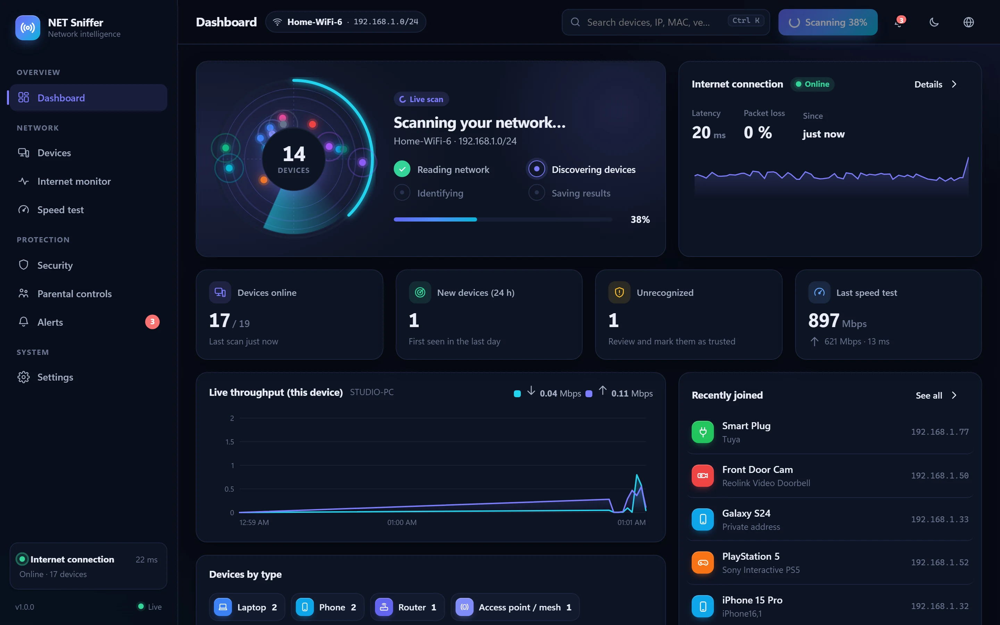 | 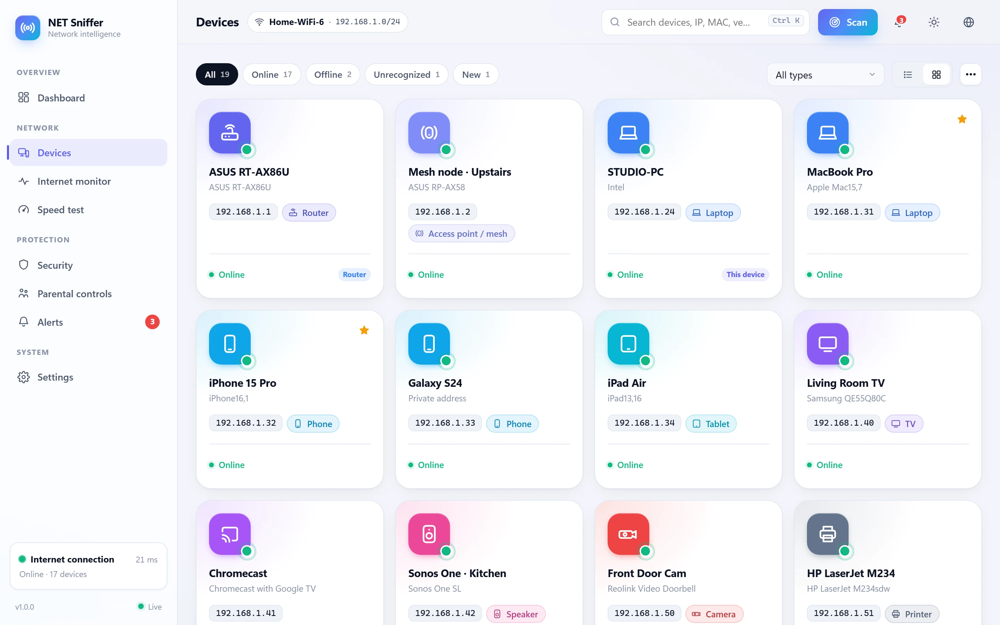 |
| 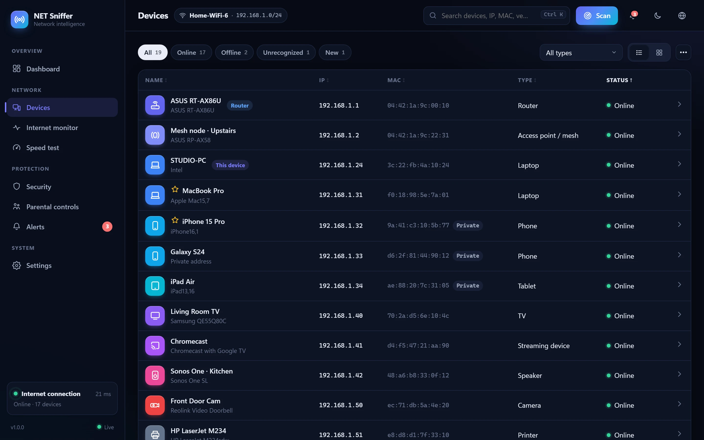 | 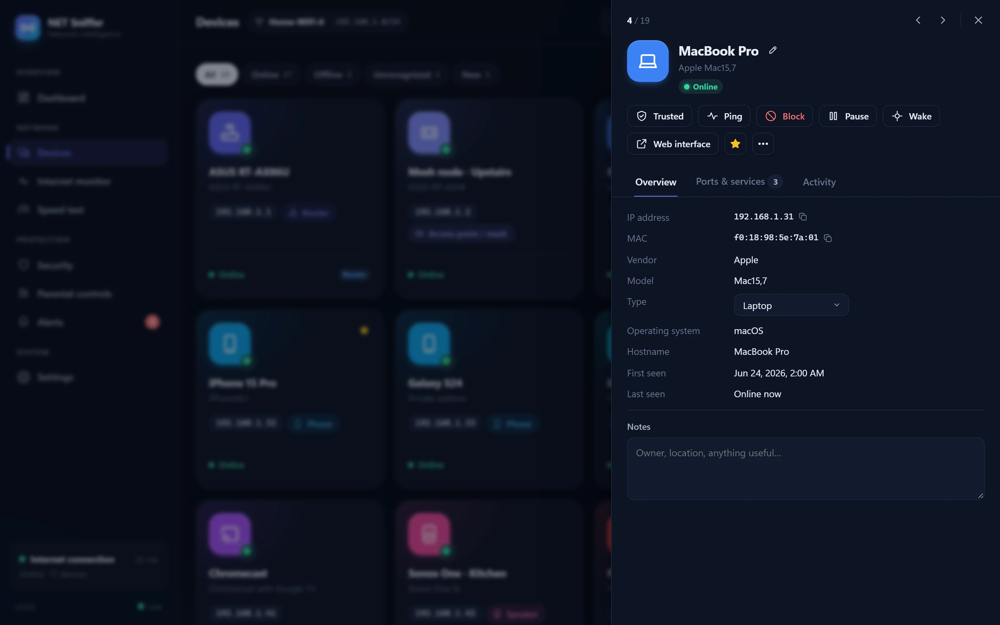 |
| 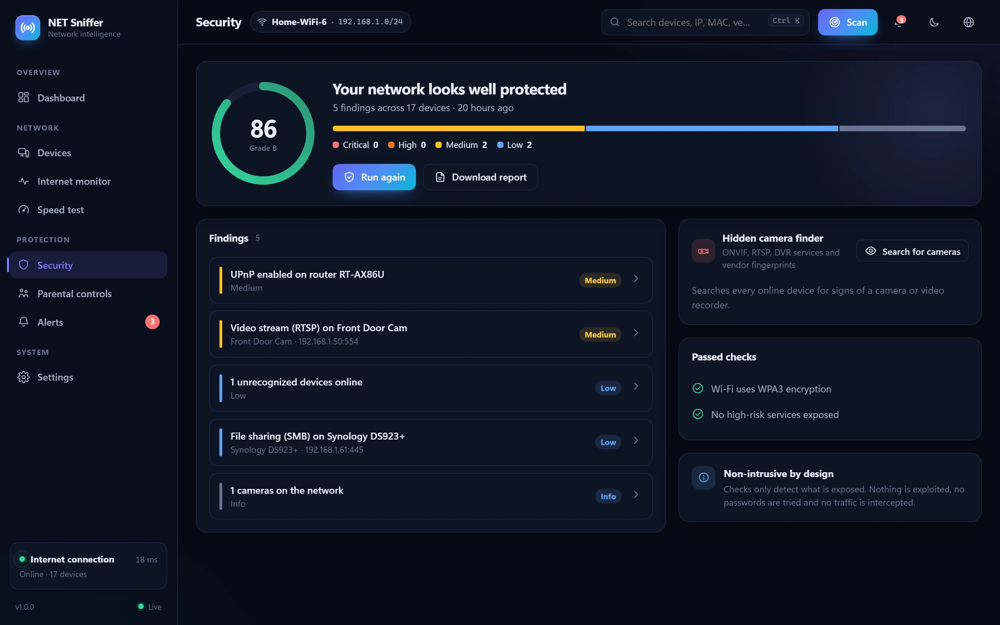 | 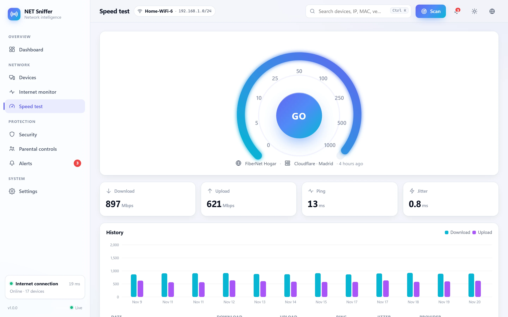 |
| 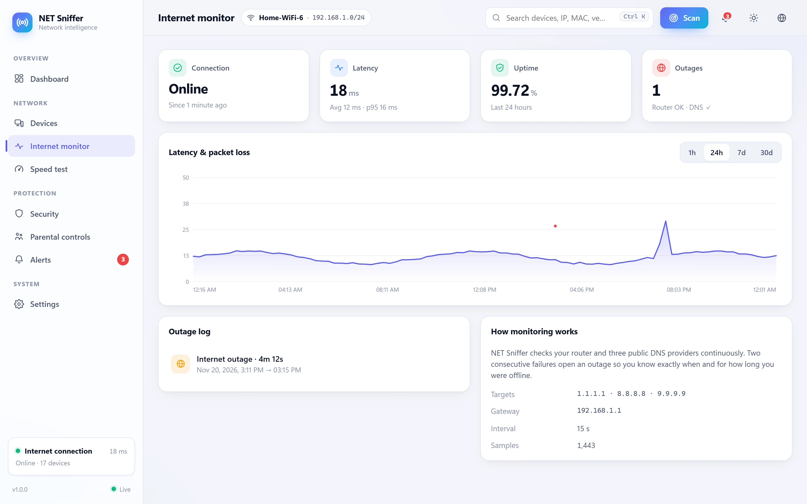 | 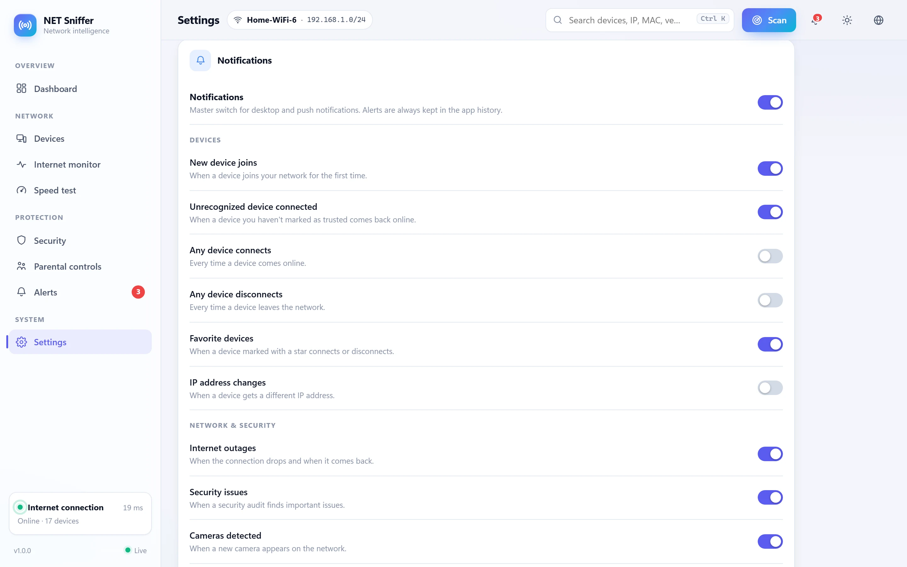 |

<p align="center">
  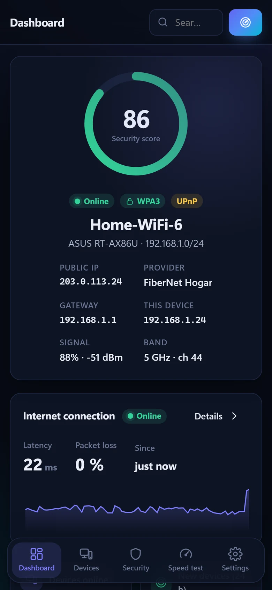
  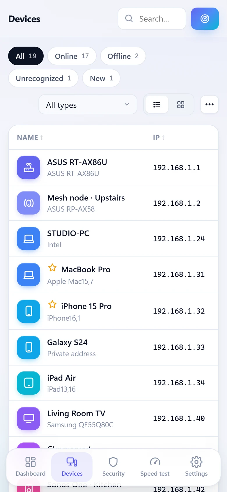
  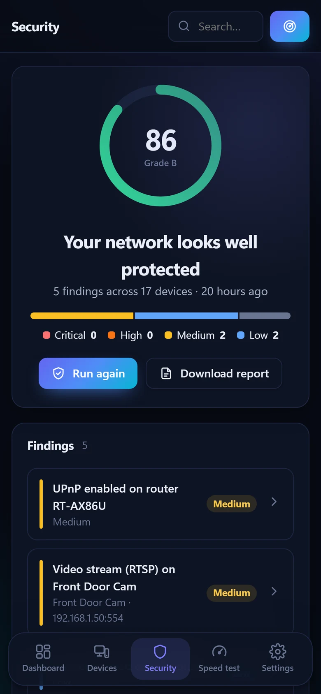
  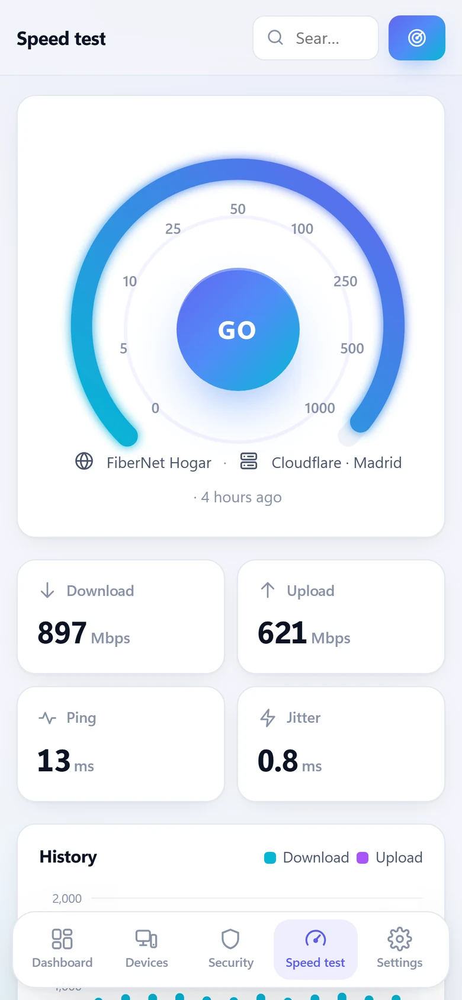
</p>

<sub>Las capturas usan el modo demo integrado con una red ficticia.</sub>

## Raspberry Pi / servidor doméstico

Funciona sin pantalla como servicio y sirve la interfaz completa a cualquier navegador de tu red:

```sh
curl -fsSL https://raw.githubusercontent.com/crazyramirez/NET-Sniffer/main/packaging/install-linux.sh | sudo sh
```

1. Abre `http://<ip-de-la-pi>:8765` en un navegador de tu red.
2. Introduce el código de configuración que muestra el instalador.
3. Elige una contraseña.

Se actualiza solo. Para acceder fuera de casa usa una VPN (WireGuard, Tailscale) en lugar de abrir puertos en el router.

## Ejecutar desde el código fuente

```sh
python -m venv .venv && . .venv/bin/activate      # Windows: .venv\Scripts\activate
pip install -r requirements-dev.txt
python -m netsniffer                  # ventana de escritorio + icono en la bandeja
python -m netsniffer --background     # arranca oculto en la bandeja
python -m netsniffer --headless       # servidor web en :8765
python -m pytest -q
```

## Compilar y publicar

| Tarea | Comando |
|---|---|
| Compilar el instalador del sistema actual | `python scripts/build.py` → `dist/` (en Windows necesita [Inno Setup 6](https://jrsoftware.org/isinfo.php)) |
| Publicar una versión nueva (desde Windows) | `.\scripts\release.ps1` (o `-Bump minor`, `-Version 2.0.0`) |
| Regenerar las capturas del README | `python scripts/screenshots.py` (modo demo + Chrome headless) |
| Regenerar las imágenes de marca | `python scripts/gen_brand_images.py` (necesita `OPENAI_API_KEY` en `.env`) |

`release.ps1`:
1. Sube la versión.
2. Pasa los tests.
3. Compila el instalador de Windows.
4. Sube el tag y publica la release en GitHub.

Al publicarse, [`.github/workflows/release.yml`](.github/workflows/release.yml):
1. Compila el `.dmg` de macOS (arm64/x64), y el `.deb` y los binarios de Linux (x64/arm64).
2. Los añade a la misma release.
3. Borra todas las releases, tags y ejecuciones anteriores.

Después, `release.ps1` espera a que termine ese workflow y descarga en `dist/` todos los instaladores de la nueva release. Las compilaciones locales siempre eliminan antes los artefactos previos.

## Arquitectura

```
netsniffer/
  __main__.py        ventana de escritorio (pywebview) + bandeja / modo servidor
  desktop.py         bandeja del sistema, segundo plano, instancia única, inicio con el sistema
  app.py             API REST + WebSocket (FastAPI), autenticación, acceso remoto
  engine.py          orquestación del descubrimiento, historial, alertas de intrusos
  net/               arp · names (mDNS/SSDP/NetBIOS/WSD) · oui · classify · ports · interfaces
  audit.py           auditoría de seguridad y detector de cámaras
  monitor.py         monitor de internet y caídas, tráfico en vivo
  speedtest.py       test de velocidad (Cloudflare)
  notify.py          reglas de notificación por evento, horas de silencio, escritorio + push
  blocking/          backends de router + horarios de control parental
  updater.py         autoactualización desde GitHub Releases (instalador / dmg / deb / binario)
  demo.py            red ficticia para capturas
  web/               interfaz (módulos ES nativos, sin compilación) + traducciones
packaging/           instalador de Windows (Inno Setup), instalador del servicio Linux, lanzador de PyInstaller
```

## Privacidad

Todo se queda en tu equipo. Conexiones externas:
- Cloudflare: test de velocidad y, de forma opcional, consulta de IP pública y proveedor.
- GitHub: comprobación de actualizaciones.
- Los servicios push que configures.

Las credenciales del router se guardan cifradas en local.
