<p align="center">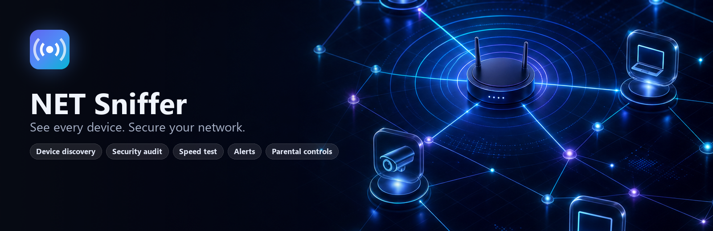</p>

<p align="center">
  <a href="https://github.com/crazyramirez/NET-Sniffer/releases/latest"></a>
  
  
  
</p>

**NET Sniffer** is a free desktop app that shows every device on your Wi-Fi/LAN, audits your network's security, tests your internet speed and alerts you the moment something changes. It keeps watching from the system tray, has a light/dark interface and speaks 7 languages.

> Built for **networks you own or administer**. NET Sniffer only uses standard discovery protocols and connection checks: no exploitation, no password guessing, no traffic interception, no ARP spoofing.

<p align="center">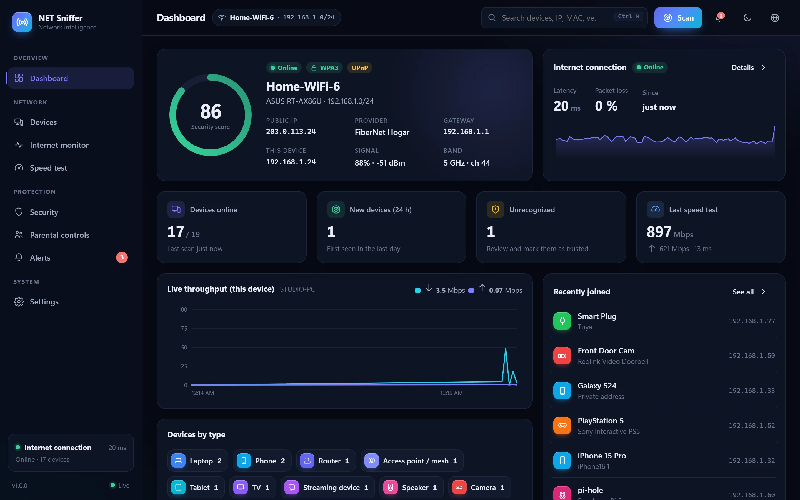</p>

## Download & install

| Platform | Installer |
|---|---|
| **Windows 10/11** (x64) | [NETSniffer-Setup-Windows-x64.exe](https://github.com/crazyramirez/NET-Sniffer/releases/latest/download/NETSniffer-Setup-Windows-x64.exe) |
| **macOS** Apple Silicon | [NETSniffer-macOS-arm64.dmg](https://github.com/crazyramirez/NET-Sniffer/releases/latest/download/NETSniffer-macOS-arm64.dmg) |
| **macOS** Intel | [NETSniffer-macOS-x64.dmg](https://github.com/crazyramirez/NET-Sniffer/releases/latest/download/NETSniffer-macOS-x64.dmg) |
| **Linux** x64 (Ubuntu, Debian, Mint…) | [NETSniffer-Linux-x64.deb](https://github.com/crazyramirez/NET-Sniffer/releases/latest/download/NETSniffer-Linux-x64.deb) |
| **Linux** ARM64 | [NETSniffer-Linux-arm64.deb](https://github.com/crazyramirez/NET-Sniffer/releases/latest/download/NETSniffer-Linux-arm64.deb) |
| **Raspberry Pi** / home server (headless) | [one-line install](#raspberry-pi--home-server) |

- **Windows**: run the setup. It installs for your user only (no administrator rights), adds Start-menu and optional desktop shortcuts, can start with Windows, and has a normal uninstaller. SmartScreen may warn because the app isn't code-signed yet: *More info* → *Run anyway*.
- **macOS**: open the `.dmg`, drag **NET Sniffer** to *Applications*, then right-click → *Open* the first time (the app isn't notarized yet).
- **Linux**: `sudo apt install ./NETSniffer-Linux-x64.deb`, then find **NET Sniffer** in your app menu. The native window and tray icon use GTK/WebKit (`gir1.2-webkit2-4.1`, `gir1.2-ayatanaappindicator3-0.1`). Without them the UI opens in your browser.

**Always up to date.** NET Sniffer checks GitHub Releases every few hours, downloads the new version in the background and installs it when you restart (or at once with *Install & restart*). Only the latest version is ever published.

## Features

**See everything on your network**
- **Device discovery**: IP, MAC, vendor (IEEE registry), model, hostname, OS guess and device type (router, phone, laptop, TV, camera, printer, console, IoT…). Uses ARP resolution, mDNS/Bonjour, NetBIOS, SSDP/UPnP and WS-Discovery, with no admin rights needed.
- **Connection history**: first/last seen, online/offline timeline, IP changes, and detection of private (randomized) MAC addresses.
- **Ports & services**: quick, common (~120) or full (~1,100) TCP port inventory per device, with service banners and risk levels.
- **Ping, Wake-on-LAN, web interface links, notes, favorites, CSV export.**

**Protect it**
- **Intruder detection**: mark your devices as trusted. New or unrecognized devices raise an alert within 90 seconds.
- **Security audit**: a score and grade for your network. It checks Wi-Fi encryption, UPnP exposure, a router admin page served without HTTPS, and risky services (Telnet, exposed databases, Docker API, ADB, VNC, RTSP…). Each finding comes with step-by-step fixes and the audit exports to an HTML report.
- **Hidden camera finder**: ONVIF discovery, RTSP/DVR services, camera vendors and web-server fingerprints.
- **Block devices & parental controls**: pause the internet for a device or on a schedule (bedtime, school hours…). Blocking is applied on *your* router through its official admin interface:
  - OpenWrt/Linux routers, over SSH with nftables/iptables
  - AVM FRITZ!Box, over TR-064
  - a Linux box acting as the gateway

**Stay informed**
- **Runs in the background**: closing the window keeps NET Sniffer in the system tray (menu bar on macOS). Monitoring and alerts continue. You can start it at login, and opening the app again brings the existing window back.
- **Notifications you control**: switch each one on or off, all from Settings:
  - a new device joins
  - an unrecognized device connects
  - any device connects or disconnects
  - favorite devices come or go
  - IP address changes
  - internet outages and recovery
  - security issues and new cameras
  
  There's also a master switch, sound and quiet hours. Every alert stays in the in-app history either way.
- **Push to your phone** via ntfy, Telegram or webhooks.
- **Internet monitor**: continuous latency and packet-loss tracking, an outage log with durations, and uptime %.
- **Speed test**: download, upload, ping and jitter (Cloudflare edge), with an animated gauge and history.
- **Remote access**: open NET Sniffer from your phone or another PC, password-protected with a QR code. Or run it 24/7 on a Raspberry Pi.

**Polished everywhere**: light and dark themes, a responsive layout for phones, and 7 languages detected from your device (Español, English, Français, Deutsch, Italiano, 中文, 日本語).

## Screenshots

| | |
|---|---|
| 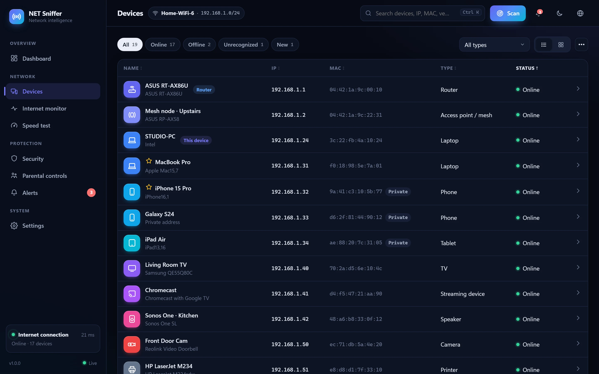 | 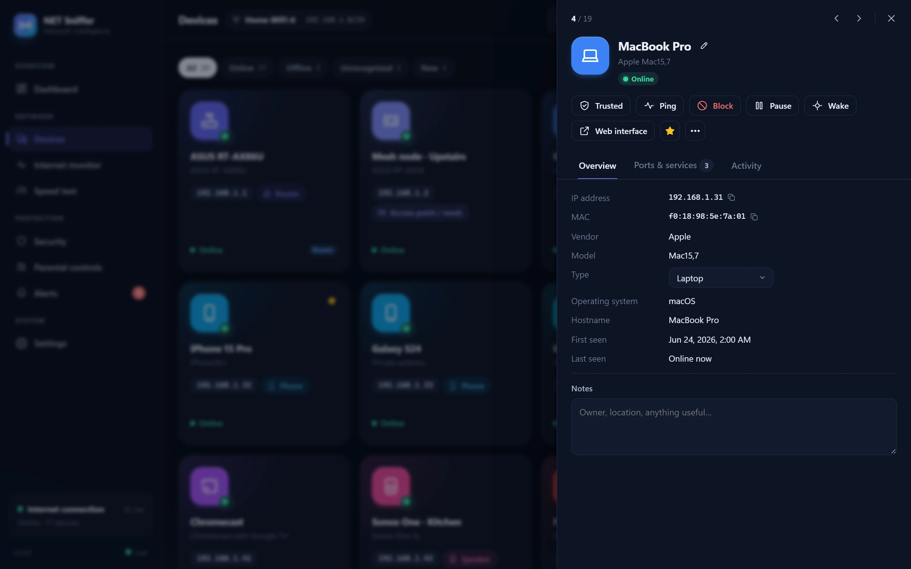 |
| 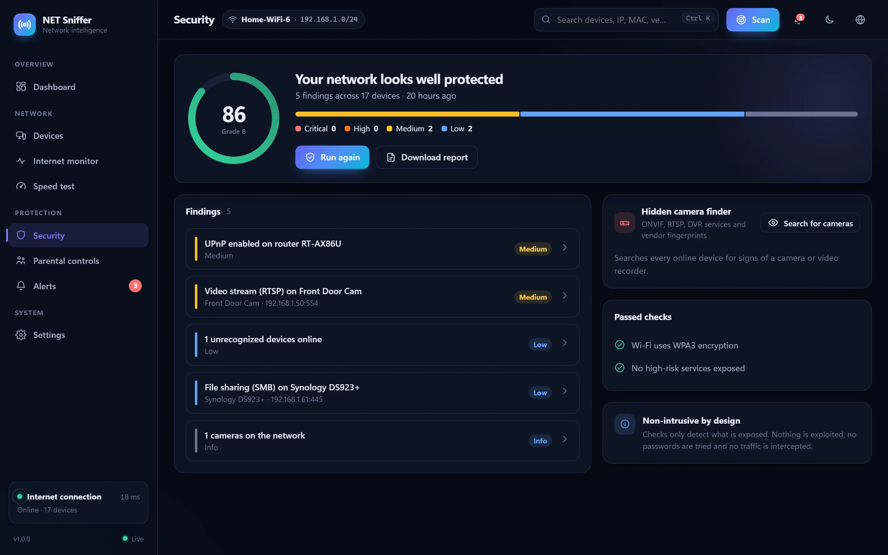 | 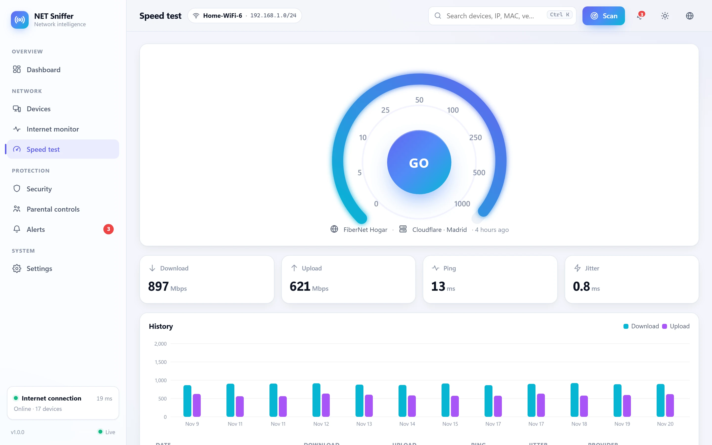 |
| 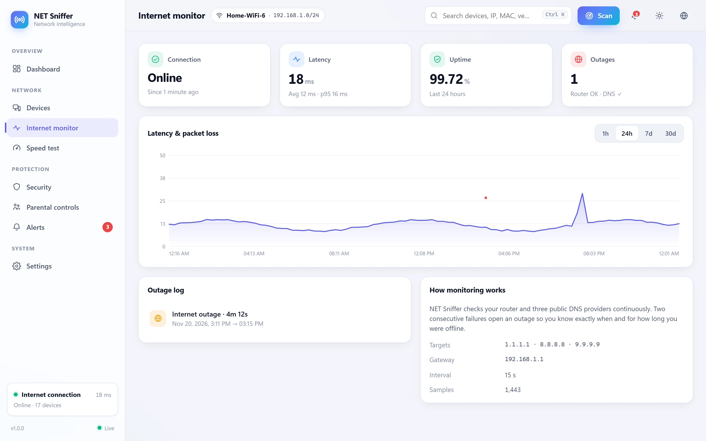 | 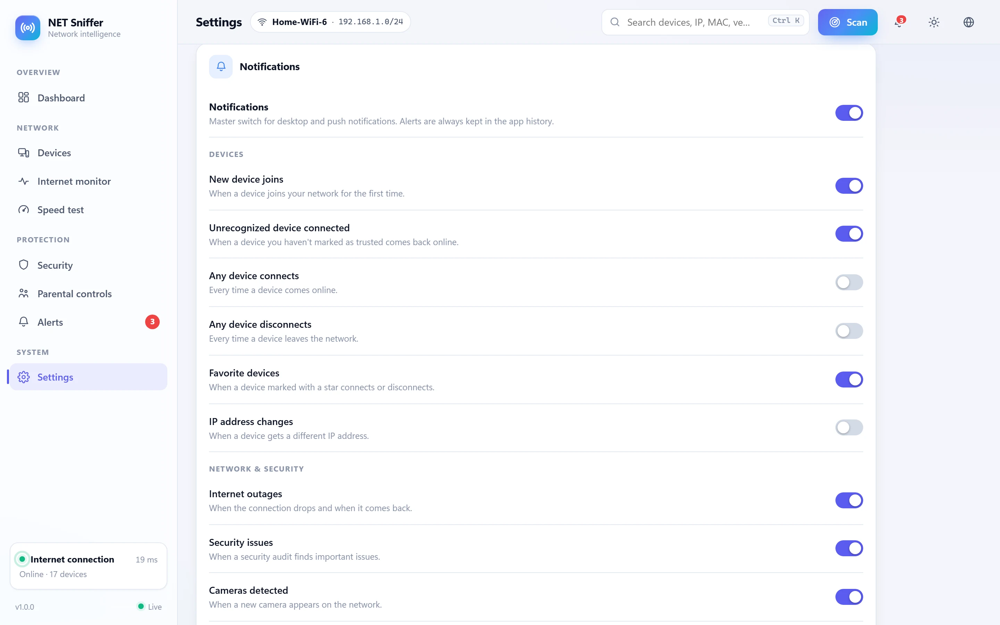 |

<p align="center">
  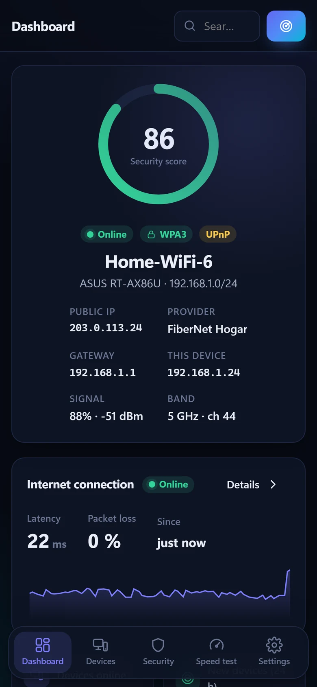
  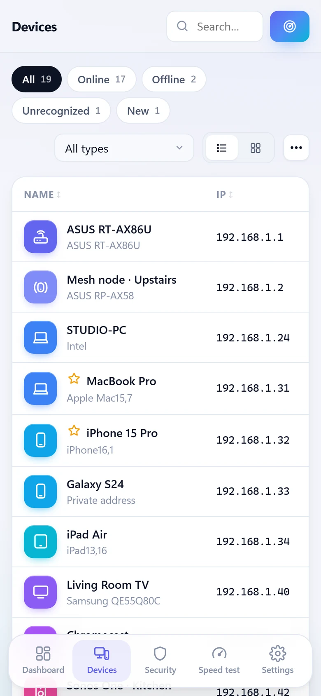
  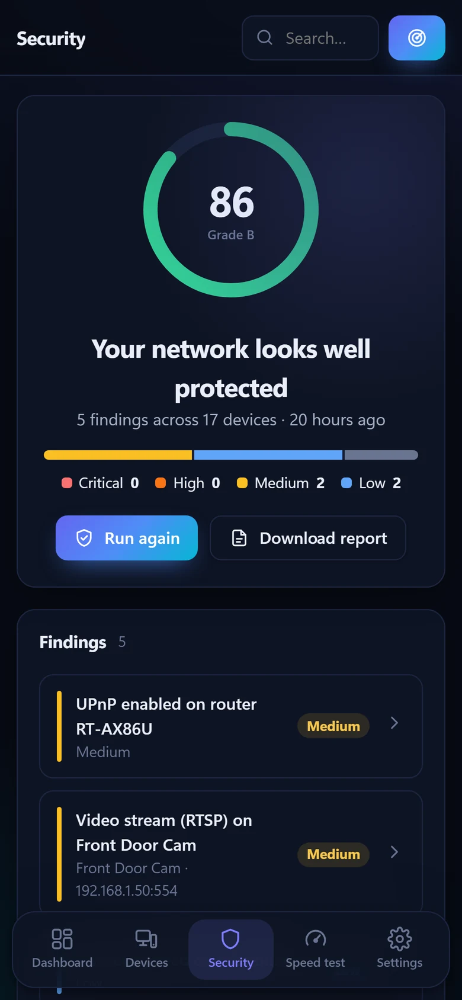
  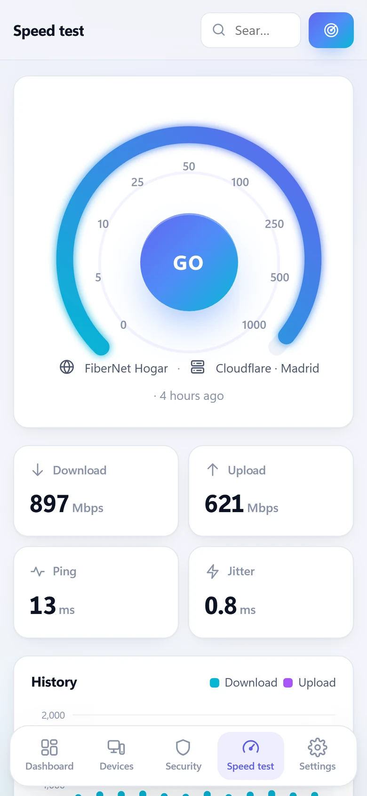
</p>

<sub>Screenshots use the built-in demo mode with a fictional network.</sub>

## Raspberry Pi / home server

Runs headless as a service and serves the full UI to any browser on your network:

```sh
curl -fsSL https://raw.githubusercontent.com/crazyramirez/NET-Sniffer/main/packaging/install-linux.sh | sudo sh
```

Open `http://<pi-ip>:8765`, enter the setup code printed by the installer and choose a password. It updates itself automatically. For access away from home, use a VPN (WireGuard/Tailscale) rather than opening router ports.

## Run from source

```sh
python -m venv .venv && . .venv/bin/activate      # Windows: .venv\Scripts\activate
pip install -r requirements-dev.txt
python -m netsniffer                  # desktop window + tray icon
python -m netsniffer --background     # start hidden in the tray
python -m netsniffer --headless       # web server on :8765
python -m pytest -q
```

## Build & release

| Task | Command |
|---|---|
| Build the installer for the current OS | `python scripts/build.py` → `dist/` (Windows needs [Inno Setup 6](https://jrsoftware.org/isinfo.php)) |
| Publish a new version (from Windows) | `.\scripts\release.ps1` (or `-Bump minor`, `-Version 2.0.0`) |
| Refresh README screenshots | `python scripts/screenshots.py` (demo mode + headless Chrome) |
| Regenerate brand images | `python scripts/gen_brand_images.py` (needs `OPENAI_API_KEY` in `.env`) |

`release.ps1` does the following:
1. Bumps the version and runs the tests.
2. Builds the Windows installer.
3. Pushes the tag and publishes the GitHub release.

Publishing the release triggers [`.github/workflows/release.yml`](.github/workflows/release.yml), which:
- builds the macOS `.dmg` (arm64/x64), plus the Linux `.deb` and standalone binaries (x64/arm64)
- attaches them to the same release
- deletes every older release, tag and workflow run

Local builds always wipe previous artifacts first.

## Architecture

```
netsniffer/
  __main__.py        desktop window (pywebview) + tray / headless launcher
  desktop.py         system tray, background mode, single instance, launch at login
  app.py             FastAPI REST + WebSocket API, auth, remote listener
  engine.py          discovery orchestration, history merge, intruder alerts
  net/               arp · names (mDNS/SSDP/NetBIOS/WSD) · oui · classify · ports · interfaces
  audit.py           security audit & camera finder
  monitor.py         internet/outage monitor, live throughput
  speedtest.py       Cloudflare speed test
  notify.py          per-event notification rules, quiet hours, desktop + push delivery
  blocking/          router backends + parental schedules
  updater.py         GitHub Releases self-update (installer / dmg / deb / binary)
  demo.py            fictional network for screenshots
  web/               UI (vanilla ES modules, no build step) + locales
packaging/           Windows installer (Inno Setup), Linux service installer, PyInstaller launcher
```

## Privacy

Everything stays on your machine. External requests: Cloudflare (speed test and optional public-IP/ISP lookup), GitHub (update checks) and the push services you configure. Router credentials are stored encrypted locally.
